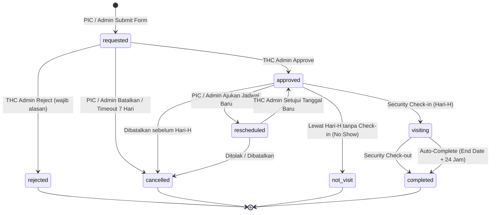

# PRD: THC Visitor Management System (VMS)

**Versi:** 3.1 (MVP Lean & High-Concurrency Architecture)  
**Status:** Approved for Development  
**Target:** Solo Fullstack Developer dengan AI Agent Coding  
**Prinsip Desain:** Clean Architecture, Clean Code, SOLID, KISS, Zero-Downtime Scalability  

---

## 1. Latar Belakang & Ringkasan Eksekutif

THC adalah perusahaan **Internet Service Provider (ISP)** terkemuka yang mengoperasikan infrastruktur jaringan telekomunikasi terdistribusi, mencakup **Kantor Cabang, POP (Point of Presence), dan miniPOP**. Setiap harinya, fasilitas-fasilitas ini menerima kunjungan dari pihak internal (tim network engineering, NOC, teknisi internal) dan pihak eksternal (vendor fiber optic, mitra kontraktor, teknisi perangkat) untuk keperluan perbaikan darurat (*troubleshooting fiber cut*), pemeliharaan berkala (*maintenance perangkat OLT/Switch/Baterai*), penyambungan (*splicing*), dan survey rute kabel.

Sistem **THC Visitor Management System (VMS)** dibangun untuk mendigitalisasi proses perizinan akses dan pencatatan teknisi/vendor ke seluruh fasilitas cabang, POP, dan miniPOP THC secara cepat, transparan, dan aman.

Dokumen PRD ini dirancang khusus untuk memandu **Solo Fullstack Developer** bersama **AI Agent Coding** agar dapat menghasilkan **MVP siap pakai dalam hitungan hari** tanpa kompleksitas berlebih (*KISS*), namun dibangun di atas fondasi **Clean Architecture** yang kokoh sehingga **tahan beban ribuan pengguna bersamaan (*high concurrency*) tanpa down atau crash**.

---

## 2. Sasaran Produk & Metrik Keberhasilan (KPI)

### 2.1 Sasaran Utama
1. **MVP Cepat & Siap Operasional**: Alur permohonan akses fasilitas POP/Cabang, persetujuan admin/NOC, check-in di pos gerbang/shelter, dan pemantauan teknisi aktif di lapangan berfungsi penuh.
2. **Kinerja Tinggi & Zero-Crash**: Sistem tetap responsif dan stabil meskipun diakses bersamaan oleh ratusan teknisi lapangan, vendor, admin, dan security.
3. **Kemudahan Pengembangan (DX)**: Kode bersih, modular, minim dependensi pihak ketiga yang rumit, dan mudah diperluas (*scalable*).

### 2.2 Target Metrik
| Metrik | Target | Metode Pengukuran |
|---|---|---|
| **Ketersediaan (*Uptime*)** | > 99.9% | Monitoring Health Endpoint (`/health`, `/ready`) |
| **Response Time API (P95)** | < 150ms | APM / HTTP Middleware Timer |
| **Daya Tampung Konkurensi** | Min. 1.000 req/detik | Load testing (k6 / Hey) tanpa memory leak |
| **Waktu Check-in Security** | < 30 detik / tim | Timestamp scan QR / input ID → Check-in sukses |
| **Waktu Pengisian Form** | < 2 menit | Form pengajuan terpadu yang ringkas di HP |

---

## 3. Cakupan Sistem: MVP vs Phase 2 & 3

Untuk mencegah *scope creep* dan kelelahan token pada AI agent, ruang lingkup dipisahkan secara tegas:

```
┌────────────────────────────────────────────────────────────────────────┐
│                   THC VMS ROADMAP (ISP FACILITIES)                     │
├────────────────────────────────┬───────────────────────────────────────┤
│          MVP (Saat Ini)        │        Phase 2 & 3 (Ekspansi)         │
├────────────────────────────────┼───────────────────────────────────────┤
│ • Auth Role-Based + JWT        │ • OIDC SSO IdP THC Nyata              │
│ • Pre-seeded Cabang, POP & Data│ • 2FA TOTP (Google Authenticator)     │
│ • Form Request Akses POP/Cabang│ • Gateway WhatsApp / SMS OTP          │
│ • Dashboard & Approval Queue   │ • UI CRUD Master Data & User Panel    │
│ • Detail & Status Timeline     │ • Survey Feedback Post-Visit          │
│ • QR Code Akses Fasilitas      │ • Incident Report Management          │
│ • Security / Site Check-in/out │ • Audit Log Viewer UI                 │
│ • Live On-Site Presence (POP)  │ • Integrasi Smart Lock IoT Shelter POP│
│ • Auto-Rule Background Worker  │ • Cetak Badge Fisik Kartu RFID        │
└────────────────────────────────┴───────────────────────────────────────┘
```

### 3.1 Dalam Cakupan MVP (In Scope)
1. **Otentikasi & Akses Berbasis Peran Terdistribusi (RBAC Multi-Cabang)**:
   - Hierarki peran bertingkat: **Superadmin (Kantor Pusat)**, **Admin Cabang / POP**, **Security**, dan **Customer / PIC Teknisi**.
   - Penugasan user internal ke fasilitas cabang/POP tertentu (`location_id`) untuk isolasi data otomatis.
   - Pendaftaran akun: Akun vendor mitra resmi (PIC) dan akun satpam cabang didaftarkan secara pre-registered/manual oleh Admin Cabang atau Superadmin.
2. **Pengajuan Akses Fasilitas (Visit Request)**: Formulir terpadu (pilih Cabang/POP/miniPOP, keperluan splicing/maint/troubleshoot, jadwal, dan daftar tim teknisi).
3. **Persetujuan (Approval Workflow Terisolasi)**: Admin Cabang hanya menyetujui kunjungan ke cabangnya sendiri; Superadmin dapat menyetujui seluruh cabang.
4. **Reschedule & Cancel**: Penjadwalan ulang dan pembatalan kunjungan oleh PIC atau Admin Cabang terkait.
5. **Security Gate & Site Check-in Fleksibel (Security & Admin Cabang)**:
   - Antrean teknisi hari ini pada pos gerbang/shelter fasilitas cabang.
   - Pemindai QR Code serbaguna: mendukung **Live Camera Scan**, **Upload Gambar QR dari Galeri/Chat (Scan File)** jika petugas sedang tidak di tempat, dan **Input Manual Visit ID**.
   - Dilakukan oleh Petugas Security maupun Admin Cabang penugasan.
6. **Live On-Site Presence Monitoring**: Pemantauan langsung siapa saja teknisi yang sedang aktif bekerja di lokasi POP tertentu (via filter tab *Sedang di Lokasi* pada Dashboard).
8. **Registrasi Akun Security Cabang**: Admin Cabang dapat mendaftarkan dan mengelola (aktif/nonaktif) akun satpam di cabangnya sendiri; Superadmin dapat mengelola security di seluruh cabang.
9. **Penyimpanan Dokumen & Object Storage (MinIO / S3)**:
   - Dukungan upload surat tugas / Surat Perintah Kerja (SPK) vendor (format PDF atau gambar).
   - Penyimpanan foto kartu identitas (KTP/SIM) dan foto bukti verifikasi check-in di pos gerbang.
10. **Persetujuan Standar K3 & SOP Keselamatan**: Konfirmasi digital via checkbox legal terintegrasi pada form.

### 3.2 Di Luar Cakupan MVP (Pindah ke Phase 2 & 3)
1. Integrasi hardware smart lock IoT pada pintu shelter miniPOP (*Phase 3*).
2. Integrasi driver printer badge kartu fisik (*Phase 3* - gunakan kartu digital di layar).
3. Modul penagihan / pembayaran / billing.
4. Form CRUD Admin untuk kelola POP/miniPOP (*MVP menggunakan database seeding*).

---

## 4. Peran Pengguna & Matriks Hak Akses (RBAC & Multi-Cabang)

Sistem menerapkan prinsip **Least Privilege** dan isolasi data per kantor cabang/POP:

| Aksi / Fitur | Superadmin (Pusat) | THC Admin Cabang | Security / Petugas Jaga | Customer / PIC (Eksternal) |
|---|:---:|:---:|:---:|:---:|
| **Cakupan Lokasi (*Scope*)** | **Seluruh Cabang / POP** | **Hanya Cabang Terkait** | **Hanya Cabang Terkait** | Global (Pilih Destinasi) |
| Login ke Sistem | Ya | Ya | Ya | Ya |
| Mengajukan Kunjungan Baru | Ya (Semua Cabang) | Ya (Cabangnya) | Tidak | Ya |
| Melihat Kunjungan Milik Sendiri | Ya | Ya | Tidak | Ya |
| Melihat Kunjungan Fasilitas Cabang | Ya (Semua) | Ya (Cabangnya) | Ya (Cabangnya, Hari Ini) | Tidak |
| Setujui / Tolak Kunjungan (*Approval*) | Ya (Semua) | Ya (Cabangnya) | Tidak | Tidak |
| Penjadwalan Ulang (*Reschedule*) | Ya | Ya (Cabangnya) | Tidak | Ya (Request) |
| Batalkan Kunjungan (*Cancel*) | Ya | Ya (Cabangnya) | Tidak | Ya |
| **Proses Check-in & Check-out Tamu** | **Ya (Bypass)** | **Ya (Di Cabangnya)** | **Ya (Di Cabangnya)** | Tidak |
| Memantau Teknisi Aktif di Fasilitas (*Live*) | Ya (Semua Cabang) | Ya (Cabangnya) | Ya (Di Cabangnya) | Tidak |
| Registrasi Akun Security Baru | Ya (Semua Cabang) | Ya (Cabang Sendiri) | Tidak | Tidak |
| Kelola Akun Security (Aktif/Nonaktif) | Ya (Semua Cabang) | Ya (Cabang Sendiri) | Tidak | Tidak |
| Mengelola Akun Admin / Superadmin | Ya | **Tidak Bisa** | **Tidak Bisa** | **Tidak Bisa** |
| Mengubah Master Data Lokasi / Tempat | Ya | **Tidak Bisa** | **Tidak Bisa** | **Tidak Bisa** |

### 4.1 Aturan Isolasi Data & Otorisasi:
1. **Superadmin (Kantor Pusat)**: Memiliki `location_id = NULL` (akses global). Dapat memfilter atau melihat data permohonan kunjungan di seluruh cabang, menyetujui kunjungan manapun, dan meregistrasikan security untuk cabang manapun.
2. **Admin Cabang / POP**: Wajib memiliki `location_id` valid. Query data kunjungan dan approval antrean secara otomatis difilter di level backend (`WHERE location_id = auth_user.location_id`). Admin Cabang **tidak dapat** melihat atau mengintervensi kunjungan cabang lain, **tidak dapat** mengelola user Admin lain, dan **hanya berwenang** mendaftarkan akun Security yang ditugaskan pada cabangnya sendiri. Admin Cabang juga memiliki wewenang untuk mengeksekusi check-in/out tamu di cabangnya.
3. **Security**: Wajib memiliki `location_id` valid. Layar gerbang (SCR-05) otomatis terkunci pada fasilitas penugasannya. Security bertugas memverifikasi identitas tamu, mencocokkan identitas dengan QR Code, serta mengeksekusi check-in/out. Security **tidak memiliki** akses menu manajemen user atau pengaturan master data fasilitas.
4. **PIC / Vendor Eksternal**: Akun didaftarkan oleh Admin THC. Memiliki `type = 'external'` dan `location_id = NULL`. Data kunjungan yang ditampilkan murni terisolasi pada `pic_user_id = auth_user.id`. PIC tidak dapat melihat daftar kunjungan vendor lain atau tombol operasional internal.

### 4.2 Aturan Operasional Check-in Fleksibel & Validitas QR Code:
1. **Dual-Role Execution**: Proses verifikasi dan check-in/check-out dapat dilakukan oleh **Security** maupun **Admin Cabang** yang bertugas di fasilitas tersebut.
2. **Triple-Mode QR Scanner (Mendukung Remote Scan)**:
   - **Mode Kamera Langsung (Live Cam)**: Pemindaian real-time saat tamu berada di depan pos gerbang/meja resepsionis.
   - **Mode Upload Gambar dari Galeri (Image/File Scan)**: Jika petugas jaga/admin sedang berada di luar pos (misal: patroli, makan, atau di ruang server), tamu dapat mengirim gambar QR Code via WhatsApp/chat online. Petugas cukup memilih/mengupload file gambar screenshot tersebut ke scanner browser untuk membaca barcode dan memproses check-in secara instan.
   - **Mode Input Manual Visit ID**: Fallback cepat jika QR code rusak atau tidak terbaca dengan mengetikkan kode unik `VST-XXXXXXXXXX`.
3. **Masa Berlaku (Validity Window) QR Code**:
   - QR Code hanya dapat di-check-in pada rentang jadwal yang disetujui ditambah **toleransi 2 jam**:
     `[Waktu Mulai - 2 Jam] s/d [Waktu Selesai + 2 Jam]`.
   - Jika check-in dicoba di luar jam toleransi ini, sistem akan menolak dengan pesan *"Kunjungan belum dibuka atau sudah melewati batas waktu toleransi."*

---

## 5. State Machine & Alur Status Kunjungan

Setiap kunjungan memiliki siklus hidup yang tercatat secara atomik pada tabel riwayat status:



---

## 6. Arsitektur Teknis & Kesiapan Skalabilitas Tinggi (*High Concurrency*)

Untuk memastikan aplikasi **tidak down atau crash** saat ribuan user mengakses secara simultan:

```
┌────────────────────────────────────────────────────────┐
│             Next.js 16.3+ (Active LTS) / React 19.3    │
│        - TanStack Query v5.103+ (Cache & Deduplication)│
│        - React Hook Form v7 + Zod v3                   │
│        - Tailwind CSS v4.3+ (Oxide High-Perf Engine)   │
└───────────────────────────┬────────────────────────────┘
                            │ HTTPS / REST JSON (JWT Auth)
                            ▼
┌────────────────────────────────────────────────────────┐
│             Go 1.27+ / Gin v1.12+ REST API Backend     │
│  ┌──────────────────────────────────────────────────┐  │
│  │ Delivery Layer (Gin Handlers & Rate Limiter)     │  │
│  ├──────────────────────────────────────────────────┤  │
│  │ Usecase Layer (Business Logic & Workflow Rules)  │  │
│  ├──────────────────────────────────────────────────┤  │
│  │ Infrastructure: pgxpool & Storage Adapter (MinIO)│  │
│  └──────────────────────────────────────────────────┘  │
│  - Stateless (Memory footprint < 30MB)                 │
│  - Concurrency via Native Goroutines                   │
└───────────────┬──────────────────────────┬─────────────┘
                │                          │
   pgxpool v5.11│                          │ minio-go/v7 S3 API
                ▼                          ▼
┌──────────────────────────────┐ ┌──────────────────────────────┐
│  PostgreSQL 18.6 Relational  │ │  MinIO Object Storage (Dev)  │
│  - Indexed Queries (B-Tree)  │ │  AWS S3 / Cloudflare R2(Prod)│
│  - ACID Transactions         │ │  - Surat Tugas / SPK (PDF)   │
│  - Connection Pool: 50-100   │ │  - Foto KTP & Bukti Check-in │
└──────────────────────────────┘ └──────────────────────────────┘
```

### 6.1 Strategi Anti-Crash & Anti-Bottleneck
1. **Stateless Backend (Go 1.27.1 / Go 1.26 LTS)**:
   - Backend tidak menyimpan session di memori server. Otentikasi divalidasi via **JWT Token (HMAC-SHA256)**.
   - Go menangani setiap request masuk dengan goroutine ringan (~2KB memori per koneksi). Server mampu melayani 10.000+ koneksi konkuren dengan CPU minimal.
2. **Database Connection Pooling (`pgxpool` v5.11+)**:
   - Mencegah kehabisan koneksi PostgreSQL (*exhaustion*). Konfigurasi:
     - `MaxConns`: 50
     - `MinConns`: 10
     - `MaxConnLifetime`: 1 jam
     - `MaxConnIdleTime`: 15 menit
3. **Database Indexing Tepat Sasaran (PostgreSQL 18.6)**:
   - Seluruh pencarian berkecepatan tinggi didukung index B-Tree:
     - `idx_visit_status`: Pencarian cepat antrean approval & live monitoring.
     - `idx_visit_date`: Filter kunjungan hari ini untuk satpam.
     - `idx_visit_id_code`: Lookup instan untuk QR Code / nomor registrasi.
     - `idx_visit_pic`: Isolasi data akun eksternal.
4. **Frontend Caching & Request Deduplication (Next.js 16.3 + TanStack Query v5.103)**:
   - Next.js menggunakan **TanStack Query v5**. Jika 100 satpam membuka dashboard bersamaan, request data master (lokasi, purpose) otomatis di-cache dan tidak menghantam server berulang kali (*staleTime: 5 menit*).
5. **Object Storage Terintegrasi (MinIO untuk Dev, S3/R2 untuk Prod)**:
   - **Local Dev**: Menjalankan **MinIO** via Docker (`minio/minio` port 9000 untuk S3 API dan port 9001 untuk Web Console). S3 Bucket: `thc-vms-bucket`.
   - **Production**: Langsung beralih ke AWS S3, Cloudflare R2, atau MinIO server mandiri tanpa merombak kode, hanya dengan mengganti environment variable (`S3_ENDPOINT`, `S3_ACCESS_KEY`, `S3_SECRET_KEY`, `S3_BUCKET`).
   - **Go Client**: `github.com/minio/minio-go/v7` dibungkus dengan interface `IStorageService` (prinsip Dependency Inversion SOLID).
   - **Kegunaan**:
     * Menyimpan dokumen PDF Surat Perintah Kerja (SPK) / Surat Tugas Vendor.
     * Menyimpan foto KTP/identitas anggota teknisi.
     * Menyimpan foto dokumentasi/selfie saat check-in di pos gerbang / shelter POP.

---

## 7. Inventori Layar MVP (5 Core Screens)

Seluruh antarmuka dikonsolidasikan ke dalam 5 layar fungsional:

| Kode Layar | Nama Layar | Pengguna | Fungsi Utama |
|---|---|---|---|
| **SCR-01** | Login Terpadu | Semua User | Login email + password, dilengkapi quick demo credentials switcher (Admin, Security, PIC). |
| **SCR-02** | Dashboard Kunjungan & Antrean | THC Admin, PIC | Tampilan monitoring permohonan akses Cabang/POP, filter tab (`Semua`, `Menunggu Approval`, `Sedang di Lokasi`, `Selesai`), dan tombol approval. |
| **SCR-03** | Form Pengajuan Akses Fasilitas | PIC Teknisi & Admin | Formulir terpadu pemilihan Cabang/POP/miniPOP, keperluan (splicing/maintenance/troubleshoot), jadwal, input tim teknisi, dan persetujuan SOP K3. |
| **SCR-04** | Detail & QR Akses Fasilitas | Semua User | Rincian izin akses, status timeline vertikal, kartu QR code akses shelter/pintu, dan tombol Reschedule/Cancel. |
| **SCR-05** | Security Gate / Site Check-in | Security / Petugas Cabang/POP | Antrean teknisi hari ini, scanner QR / input manual Visit ID, dan tombol aksi instan Check-in & Check-out. |

---

## 8. Panduan Teknis & Struktur Repositori (Clean Architecture)

Proyek dikelola dalam struktur **Monorepo** yang rapi dan mudah dinavigasi:

```text
thc-vms/
├── backend/                  # Go 1.27+ Gin Clean Architecture
│   ├── cmd/server/main.go    # Entry point & Dependency Injection
│   ├── internal/
│   │   ├── domain/           # Entities, Structs, Storage/Repo Interfaces
│   │   ├── usecase/          # Business Rules (Visit, Auth, Security)
│   │   ├── repository/       # PostgreSQL DB Access (pgx + sqlc)
│   │   ├── infrastructure/   # Object Storage (MinIO/S3), Mailer
│   │   └── delivery/http/    # Gin Handlers, Middlewares, Routes
│   ├── migrations/           # SQL Migration Files (golang-migrate)
│   └── seeds/                # Seed Data (Admin, Security, Lokasi, Purpose)
├── frontend/                 # Next.js 16.3+ (App Router) + React 19.3
│   ├── src/
│   │   ├── app/              # Next.js App Routes (pages)
│   │   ├── features/         # Feature-based Modules (auth, visits, security)
│   │   ├── components/ui/    # Atomic UI (Button, Card, Input, Modal, Badge)
│   │   └── lib/              # API Client (Axios/Fetch), React Query Provider
│   └── app/globals.css       # Tailwind CSS v4 CSS-First Tokens
└── docs/                     # Dokumentasi Spesifikasi & Panduan
```

---

## 9. Kriteria Penerimaan (Acceptance Criteria) MVP

1. **Keberhasilan Alur End-to-End**:
   - PIC dapat login, mengisi form pengajuan dengan data rombongan teknisi, mengunggah dokumen Surat Tugas / SPK (PDF/Gambar), dan menerima Visit ID.
   - Dokumen tersimpan aman di MinIO/S3 dan dapat di-download/preview oleh admin.
   - THC Admin dapat melihat permohonan tersebut di antrean approval dan melakukan Approve.
   - Kunjungan yang disetujui menampilkan kartu QR Code di halaman detail.
   - Security/Admin dapat mencari Visit ID / memindai QR (kamera atau upload galeri), memverifikasi tamu, dan menekan Check-in.
   - Tamu yang sudah check-in langsung muncul di tab *Sedang di Lokasi* (`status = visiting`) pada Dashboard.
   - Security/Admin menekan Check-out saat kunjungan selesai; status otomatis menjadi *Completed*.
2. **Uji Ketahanan Beban**:
   - Sistem berhasil melayani 1.000 request bersamaan tanpa mengembalikan status `500 Internal Server Error` atau mengalami *deadlock* basis data.