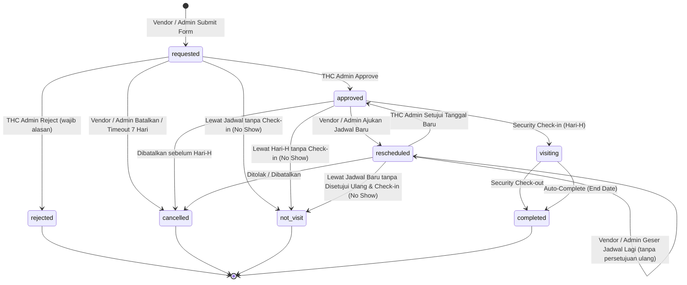

# PRD: THC Visitor Management System (VMS)

**Versi:** 3.1 (MVP Lean & High-Concurrency Architecture)  
**Status:** Approved for Development  
**Target:** Solo Fullstack Developer dengan AI Agent Coding  
**Prinsip Desain:** Clean Architecture, Clean Code, SOLID, KISS, Zero-Downtime Scalability  

---

## 1. Latar Belakang & Ringkasan Eksekutif

THC adalah perusahaan **Internet Service Provider (ISP)** terkemuka yang mengoperasikan infrastruktur jaringan telekomunikasi terdistribusi, mencakup **Kantor Cabang, POP (Point of Presence), dan miniPOP**. Setiap harinya, fasilitas-fasilitas ini menerima kunjungan dari pihak internal (tim network engineering, NOC, teknisi internal) dan pihak eksternal (vendor fiber optic, mitra kontraktor, teknisi perangkat) untuk keperluan perbaikan darurat (*troubleshooting fiber cut*), pemeliharaan berkala (*maintenance perangkat OLT/Switch/Baterai*), penyambungan (*splicing*), dan survey rute kabel.

Sistem **THC Visitor Management System (VMS)** dibangun untuk mendigitalisasi proses perizinan akses dan pencatatan teknisi/vendor ke seluruh fasilitas cabang, POP, dan miniPOP THC secara cepat, transparan, dan aman.

Dokumen PRD ini dirancang khusus untuk memandu **Solo Fullstack Developer** bersama **AI Agent Coding** agar dapat menghasilkan **MVP siap pakai dalam hitungan hari** tanpa kompleksitas berlebih (*KISS*), namun dibangun di atas fondasi **Clean Architecture** yang kokoh sehingga **tahan beban ribuan pengguna bersamaan (*high concurrency*) tanpa down atau crash**.

---

## 2. Sasaran Produk & Metrik Keberhasilan (KPI)

### 2.1 Sasaran Utama
1. **MVP Cepat & Siap Operasional**: Alur permohonan akses fasilitas POP/Cabang, persetujuan admin/NOC, check-in di pos gerbang/shelter, dan pemantauan teknisi aktif di lapangan berfungsi penuh.
2. **Kinerja Tinggi & Zero-Crash**: Sistem tetap responsif dan stabil meskipun diakses bersamaan oleh ratusan teknisi lapangan, vendor, admin, dan security.
3. **Kemudahan Pengembangan (DX)**: Kode bersih, modular, minim dependensi pihak ketiga yang rumit, dan mudah diperluas (*scalable*).

### 2.2 Target Metrik
| Metrik | Target | Metode Pengukuran |
|---|---|---|
| **Ketersediaan (*Uptime*)** | > 99.9% | Monitoring Health Endpoint (`/health`, `/ready`) |
| **Response Time API (P95)** | < 150ms | APM / HTTP Middleware Timer |
| **Daya Tampung Konkurensi** | Min. 1.000 req/detik | Load testing (k6 / Hey) tanpa memory leak |
| **Waktu Check-in Security** | < 30 detik / tim | Timestamp scan QR / input ID → Check-in sukses |
| **Waktu Pengisian Form** | < 2 menit | Form pengajuan terpadu yang ringkas di HP |

---

## 3. Cakupan Sistem MVP

Fokus pengembangan hanya pada MVP di bawah ini — software dan fitur useful
saja. Tidak ada Phase 2/3 (tanpa integrasi hardware/IoT); kebutuhan baru ke
depan dinilai terpisah sebagai scope tersendiri.

Daftar cakupan MVP:
- Auth Role-Based + JWT
- Pre-seeded Cabang, POP & Data
- Form Request Akses POP/Cabang
- Dashboard & Approval Queue
- Detail & Status Timeline
- QR Code Akses Fasilitas
- Security / Site Check-in/out
- Live On-Site Presence (POP)
- Auto-Rule Background Worker

### 3.1 Dalam Cakupan MVP (In Scope)
1. **Otentikasi & Akses Berbasis Peran Terdistribusi (RBAC Multi-Cabang)**:
   - Hierarki peran bertingkat: **Superadmin (Kantor Pusat)**, **Admin Cabang / POP (Koordinator Wilayah)**, **Security**, dan **Customer / Vendor (Teknisi Mitra)**.
   - Penugasan user internal ke fasilitas cabang/POP: setiap akun `admin`/`security` wajib memiliki `location_id` primary, dan dapat menjangkau lebih dari satu cabang lewat tabel `user_locations` (migrasi `000023`) yang menyimpan union cakupan (primary + cabang tambahan). Isolasi data otomatis ditegakkan per-request oleh resolver `AccessibleLocationIDs` yang membaca `user_locations` dan men-stash hasilnya (`thc.scope`) pada konteks request; query read memakai pasangan bound parameter `is_global` + `location_ids` (union): `is_global OR location_id = ANY(location_ids)` untuk kunjungan, dan `EXISTS (SELECT 1 FROM user_locations ...)` untuk users/notifikasi. Union kosong dengan `is_global=false` bersifat fail-closed (tidak mengembalikan baris apa pun). **Admin/koordinator dan security ter-scope** pada union cabangnya; **superadmin global** (`is_global=true`, union kosong) atau dapat menyempit ke satu cabang (`is_global=false` + satu id); **vendor tetap owner-path** `vendor_user_id = auth_user.id` dan tidak terpengaruh multi-branch.
   - Pendaftaran akun: Akun vendor mitra dapat didaftarkan secara pre-registered/manual oleh Admin Cabang atau Superadmin, ATAU mendaftar mandiri lewat halaman publik (`POST /auth/register`) yang membuat akun berstatus `pending` dan tidak dapat masuk sampai superadmin menyetujuinya (`PATCH /users/{id}/status`). Akun pengawas cabang didaftarkan secara pre-registered/manual oleh Admin Cabang atau Superadmin.
2. **Pengajuan Akses Fasilitas (Visit Request)**: Formulir terpadu (pilih Cabang/POP/miniPOP, keperluan splicing/maint/troubleshoot, jadwal, dan daftar anggota/pengunjung yang akan datang).
3. **Persetujuan (Approval Workflow Terisolasi)**: Admin Cabang hanya menyetujui kunjungan ke cabangnya sendiri; Superadmin dapat menyetujui seluruh cabang.
4. **Reschedule & Cancel**: Penjadwalan ulang dan pembatalan kunjungan oleh vendor atau Admin Cabang terkait.
5. **Security Gate & Site Check-in Fleksibel (Security & Admin Cabang)**:
   - Antrean teknisi hari ini pada pos gerbang/shelter fasilitas cabang.
   - Pemindai QR Code serbaguna: mendukung **Live Camera Scan**, **Upload Gambar QR dari Galeri/Chat (Scan File)** jika petugas sedang tidak di tempat, dan **Input Manual Visit ID**.
   - Dilakukan oleh Petugas Security maupun Admin Cabang penugasan.
6. **Live On-Site Presence Monitoring**: Pemantauan langsung siapa saja teknisi yang sedang aktif bekerja di lokasi POP tertentu (via filter tab *Sedang di Lokasi* pada Dashboard).
8. **Registrasi Akun Security Cabang**: Admin Cabang dapat mendaftarkan dan mengelola (aktif/nonaktif) akun pengawas di cabangnya sendiri; Superadmin dapat mengelola security di seluruh cabang.
9. **Penyimpanan Dokumen & Object Storage (MinIO / S3)**:
   - Dukungan upload surat tugas / Surat Perintah Kerja (SPK) vendor (format PDF atau gambar).
   - Penyimpanan foto kartu identitas (KTP/SIM) dan foto bukti verifikasi check-in di pos gerbang.
10. **Persetujuan Standar K3 & SOP Keselamatan**: Konfirmasi digital via checkbox legal terintegrasi pada form.
11. **Ganti Email Mandiri (Self-Service)**: pengguna dapat meminta tautan verifikasi ke email baru (`POST /auth/email-change/request`, wajib `current_password`) dan mengonfirmasinya (`POST /auth/email-change/confirm`); `PATCH /auth/me` tetap menolak field `email`. Rate-limited in-memory (3/jam per user, 10/jam per IP, 3/jam per target, 10/jam confirm). Tautan mengarah ke `{FRONTEND_BASE_URL}/verify-email?token=...`.
12. **Email Anggota & QR Tim (Team QR)**: setiap anggota kunjungan dapat memiliki email opsional (`visitor.email`, migrasi `000022`); bila terisi, anggota tersebut ikut menerima fan-out email pada semua event kunjungan (approved, rejected, cancelled, rescheduled, reminder, check-in, check-out). Email persetujuan menyertakan **satu QR Code tim** (satu QR untuk 1 tim; pindai sekali untuk check-in bersama dan sekali lagi untuk check-out bersama) yang disematkan inline (CID) pada pesan HTML.
13. **Penyatuan Lonceng Notifikasi (Bell Unification)**: lonceng notifikasi menyatukan feed notifikasi kunjungan (tabel `notification`) dan antrean pendaftaran vendor pending (tabel `vendor_registration_notices`) untuk superadmin; badge menghitung gabungan unread + pending registrations. Antrean pendaftaran vendor bukan tipe notifikasi kunjungan, tetapi ditampilkan terpadu di lonceng.

---

## 4. Peran Pengguna & Matriks Hak Akses (RBAC & Multi-Cabang)

Sistem menerapkan prinsip **Least Privilege** dan isolasi data per kantor cabang/POP:

| Aksi / Fitur | Superadmin (Pusat) | THC Admin Cabang | Security / Petugas Jaga | Customer / Vendor (Eksternal) |
|---|:---:|:---:|:---:|:---:|
| **Cakupan Lokasi (*Scope*)** | **Seluruh Cabang / POP** | **Hanya Cabang Terkait** | **Hanya Cabang Terkait** | Global (Pilih Destinasi) |
| Login ke Sistem | Ya | Ya | Ya | Ya |
| Mengajukan Kunjungan Baru | Ya (Semua Cabang) | Ya (Cabangnya) | Tidak | Ya |
| Melihat Kunjungan Milik Sendiri | Ya | Ya | Tidak | Ya |
| Melihat Kunjungan Fasilitas Cabang | Ya (Semua) | Ya (Cabangnya) | Ya (Cabangnya) | Tidak |
| Setujui / Tolak Kunjungan (*Approval*) | Ya (Semua) | Ya (Cabangnya) | Tidak | Tidak |
| Penjadwalan Ulang (*Reschedule*) | Ya | Ya (Cabangnya) | Tidak | Ya (Request) |
| Batalkan Kunjungan (*Cancel*) | Ya | Ya (Cabangnya) | Tidak | Ya |
| **Proses Check-in & Check-out Tamu** | **Ya (Bypass)** | **Ya (Di Cabangnya)** | **Ya (Di Cabangnya)** | Tidak |
| Memantau Teknisi Aktif di Fasilitas (*Live*) | Ya (Semua Cabang) | Ya (Cabangnya) | Ya (Di Cabangnya) | Tidak |
| Registrasi Akun Security Baru | Ya (Semua Cabang) | Ya (Cabang Sendiri) | Tidak | Tidak |
| Kelola Akun Security (Aktif/Nonaktif) | Ya (Semua Cabang) | Ya (Cabang Sendiri) | Tidak | Tidak |
| Memindahkan Akun Security ke Cabang Lain (Mutasi `location_id`) | Ya (Semua Cabang) | **Tidak Bisa** | **Tidak Bisa** | **Tidak Bisa** |
| Hapus Akun Security / Pengawas (Hard Delete) | Ya (Semua Cabang) | Ya (Cabang Sendiri) | **Tidak Bisa** | **Tidak Bisa** |
| Hapus Akun Admin / Vendor | Ya | **Tidak Bisa** | **Tidak Bisa** | **Tidak Bisa** |
| Hapus Permanen Kunjungan (Delete Visit) | Ya | **Tidak Bisa** | **Tidak Bisa** | **Tidak Bisa** |
| Hapus Master Data Lokasi | Ya | **Tidak Bisa** | **Tidak Bisa** | **Tidak Bisa** |
| Mengelola Akun Admin / Superadmin | Ya | **Tidak Bisa** | **Tidak Bisa** | **Tidak Bisa** |
| Mengubah Master Data Lokasi / Tempat | Ya | **Tidak Bisa** | **Tidak Bisa** | **Tidak Bisa** |

### 4.1 Aturan Isolasi Data & Otorisasi:
1. **Superadmin (Kantor Pusat)**: Memiliki `location_id = NULL` (akses global). Dapat memfilter atau melihat data permohonan kunjungan di seluruh cabang, menyetujui kunjungan manapun, dan meregistrasikan security untuk cabang manapun. Superadmin adalah **satu-satunya peran yang boleh menghapus record** (kunjungan, akun admin/vendor/security, dan master lokasi). Scope per-request: `is_global = true` dengan union kosong (nasional) atau `is_global = false` + satu id untuk menyempit ke satu cabang.
2. **Admin Cabang / POP (Koordinator Wilayah)**: Wajib memiliki `location_id` primary valid dan dapat menjangkau lebih dari satu cabang lewat `user_locations` (coverage). Query data kunjungan dan approval antrean difilter di level backend dengan pasangan bound parameter `is_global` + `location_ids` (union): `is_global OR location_id = ANY(location_ids)` untuk kunjungan; users/notifikasi menambah `EXISTS (SELECT 1 FROM user_locations ...)`. Admin **tidak dapat** melihat atau mengintervensi kunjungan cabang di luar union-nya; scope menyusut seketika bila coverage dicabut (scope-after-removal). Admin **tidak dapat** mengelola user Admin lain, dan **hanya berwenang** mendaftarkan, menonaktifkan, dan menghapus akun Security yang ditugaskan pada cabang dalam union-nya. Admin juga memiliki wewenang untuk mengeksekusi check-in/out tamu di cabangnya. **Pemindahan akun Security ke cabang lain** (`location_id`) hak aksesnya **khusus Superadmin**; Admin Cabang yang mengirim member tersebut pada `PATCH /users/security/{id}` mendapat 403.
3. **Security**: Wajib memiliki `location_id` primary valid dan dapat menjangkau lebih dari satu cabang lewat `user_locations`. Layar gerbang (SCR-05) otomatis terkunci pada fasilitas penugasannya (union). Security bertugas memverifikasi identitas tamu, mencocokkan identitas dengan QR Code, serta mengeksekusi check-in/out. Security **tidak memiliki** akses menu manajemen user atau pengaturan master data fasilitas.
4. **Vendor Eksternal**: Akun didaftarkan oleh Admin THC atau mendaftar mandiri lewat halaman publik (`POST /auth/register`) yang membuat akun berstatus `pending` dan tidak dapat masuk sampai superadmin menyetujuinya. Memiliki `type = 'external'` dan `location_id = NULL`. Data kunjungan yang ditampilkan murni terisolasi pada `vendor_user_id = auth_user.id` (owner-path, tidak terpengaruh multi-branch). Vendor tidak dapat melihat daftar kunjungan vendor lain atau tombol operasional internal.

### 4.2 Aturan Operasional Check-in Fleksibel & Validitas QR Code:
1. **Dual-Role Execution**: Proses verifikasi dan check-in/check-out dapat dilakukan oleh **Security** maupun **Admin Cabang** yang bertugas di fasilitas tersebut.
2. **Triple-Mode QR Scanner (Mendukung Remote Scan)**:
   - **Mode Kamera Langsung (Live Cam)**: Pemindaian real-time saat tamu berada di depan pos gerbang/meja resepsionis.
   - **Mode Upload Gambar dari Galeri (Image/File Scan)**: Jika petugas jaga/admin sedang berada di luar pos (misal: patroli, makan, atau di ruang server), tamu dapat mengirim gambar QR Code via WhatsApp/chat online. Petugas cukup memilih/mengupload file gambar screenshot tersebut ke scanner browser untuk membaca barcode dan memproses check-in secara instan.
   - **Mode Input Manual Visit ID**: Fallback cepat jika QR code rusak atau tidak terbaca dengan mengetikkan kode unik `VST-XXXXXXXXXX`.
3. **Masa Berlaku (Validity Window) QR Code**:
   - QR Code hanya dapat di-check-in pada rentang jadwal yang disetujui ditambah **toleransi 2 jam di awal jendela** (agar teknisi yang datang lebih awal tetap bisa masuk):
     `[Waktu Mulai - 2 Jam] s/d [Waktu Selesai]` (inklusif, tanpa grace setelah `end_date`).
   - **[SUPERSEDED — multi-entry]** Toleransi **+2 jam setelah `end_date`** dihapus: tepat saat `end_date` tiba permit ditutup otomatis oleh R3 (`completed`), sehingga tidak ada lagi check-in pasca-jadwal.
   - Jika check-in dicoba di luar jam toleransi ini, sistem akan menolak dengan pesan *"Kunjungan belum dibuka atau sudah melewati batas waktu toleransi."*

---

## 5. State Machine & Alur Status Kunjungan

Setiap kunjungan memiliki siklus hidup yang tercatat secara atomik pada tabel riwayat status:



> **Aturan persetujuan ulang:** perubahan jadwal HARUS disetujui kembali oleh admin/superadmin sebelum check-in (`rescheduled → approved → visiting`; check-in langsung dari `rescheduled` ditolak). Jadwal boleh digeser berulang kali tanpa persetujuan (`rescheduled → rescheduled` diizinkan). Status `rescheduled` bersifat informasional (badge + riwayat) di atas aturan tersebut.

> **Notifikasi pengingat (R4):** kunjungan berstatus `approved` yang `start_date`-nya jatuh di rentang **45 menit ke depan** menerima **tepat satu** notifikasi ke akun vendor pengaju. R4 **bukan** transisi status — hanya aksi notifikasi pada sweep background yang sama.

> **Pembedaan pembatalan:** `visit_cancelled` = pembatalan oleh manusia (vendor membatalkan kunjungannya sendiri → notifikasi ke staff; admin/superadmin membatalkan → notifikasi ke vendor). `visit_auto_cancelled` = pembatalan otomatis oleh worker. **[SUPERSEDED — multi-entry]** Definisi lama (R1 7 hari tanpa approval dengan `end_date` belum lewat 2 jam; R2 no-show `end_date` + 2 jam tanpa check-in → `not_visit`) digantikan: R1 = `requested` dengan `start_date <= now()` dan `end_date` masih di dalam guard 2 jam; R2 = nol entry hingga `end_date` (`approved`/`rescheduled` tepat `end_date`, `requested` setelah guard R1 lewat) → `cancelled` + `visit_auto_cancelled` ke vendor dan staff cabang. R3 auto-complete (`completed` oleh worker) mengirim `visit_check_out` bertanda "(Otomatis)" ke staff. Fan-out notifikasi: audience `staff` = super_admin nasional (termasuk dev-superadmin) + admin/security cabang kunjungan; audience `vendor` = akun vendor pengaju (hanya role `vendor` & aktif).

| Tipe notifikasi | Pemicu | Audience |
|---|---|---|
| `visit_requested` | pembuatan kunjungan | staff |
| `visit_approved` / `visit_rejected` | approval | vendor |
| `visit_rescheduled` | perubahan jadwal | staff + vendor |
| `visit_check_in` / `visit_check_out` | gate | staff |
| `visit_cancelled` | pembatalan manusia | staff (jika vendor cancel) / vendor (jika admin cancel) |
| `visit_auto_cancelled` | worker R1/R2 | vendor |
| `visit_reminder` | worker R4 | vendor |
>
> **Catatan email anggota:** bila `visitor.email` terisi, anggota tersebut ikut menerima fan-out email pada semua event kunjungan (approved, rejected, cancelled, rescheduled, reminder, check-in, check-out); email persetujuan menyertakan QR Code tim (satu QR untuk 1 tim). **Antrean pendaftaran vendor** (`vendor_registration_notices`) ditampilkan terpadu di lonceng notifikasi superadmin, bukan sebagai tipe notifikasi kunjungan.

> **Penjadwalan auto-rule:** **[SUPERSEDED — multi-entry]** R1 kini = `requested` & `start_date <= now()` dengan guard `end_date > now() - 2 jam`; R2 = nol entry hingga `end_date` untuk `approved`/`rescheduled` (tepat `end_date`) dan `requested` setelah guard R1 lewat; R3 = auto-complete tepat `end_date` untuk `visiting`/`offsite` (tanpa +24 jam); R4 tetap 45 menit sebelum `start_date`, dan keempatnya dijalankan oleh **satu goroutine in-process** — bukan cron terpisah — dengan interval dari env `WORKER_INTERVAL` (default 15 menit). Urutan eksekusi satu sweep: **R2 → R1 → R3 → R4**. Alur lengkapnya pada `docs/2. User Flow Diagram/2.6 Flow Auto-Rules (Background Job).mermaid`, matriks ujinya pada `docs/6. QA_CHECKLIST.md` bagian 5.

> **Tier polling frontend** (pelengkap worker, bukan pengganti): daftar kunjungan 30 dtk; kios gerbang 15 dtk; resolver `/qr` 30 dtk hanya selama kunjungan belum resolved (conditional); detail kunjungan 60 dtk untuk `approved`/`visiting` (30 dtk khusus `visiting`). Semua berhenti saat tab tersembunyi.

---

## 6. Arsitektur Teknis & Kesiapan Skalabilitas Tinggi (*High Concurrency*)

Untuk memastikan aplikasi **tidak down atau crash** saat ribuan user mengakses secara simultan:

```
┌────────────────────────────────────────────────────────┐
│             Next.js 16.3+ (Active LTS) / React 19.3    │
│        - TanStack Query v5.103+ (Cache & Deduplication)│
│        - React Hook Form v7 + Zod v3                   │
│        - Tailwind CSS v4.3+ (Oxide High-Perf Engine)   │
└───────────────────────────┬────────────────────────────┘
                            │ HTTPS / REST JSON (JWT Auth)
                            ▼
┌────────────────────────────────────────────────────────┐
│             Go 1.27+ / Gin v1.12+ REST API Backend     │
│  ┌──────────────────────────────────────────────────┐  │
│  │ Delivery Layer (Gin Handlers & Rate Limiter)     │  │
│  ├──────────────────────────────────────────────────┤  │
│  │ Usecase Layer (Business Logic & Workflow Rules)  │  │
│  ├──────────────────────────────────────────────────┤  │
│  │ Infrastructure: pgxpool & Storage Adapter (MinIO)│  │
│  └──────────────────────────────────────────────────┘  │
│  - Stateless (Memory footprint < 30MB)                 │
│  - Concurrency via Native Goroutines                   │
└───────────────┬──────────────────────────┬─────────────┘
                │                          │
   pgxpool v5.11│                          │ minio-go/v7 S3 API
                ▼                          ▼
┌──────────────────────────────┐ ┌──────────────────────────────┐
│  PostgreSQL 18.6 Relational  │ │  MinIO Object Storage (Dev)  │
│  - Indexed Queries (B-Tree)  │ │  AWS S3 / Cloudflare R2(Prod)│
│  - ACID Transactions         │ │  - Surat Tugas / SPK (PDF)   │
│  - Connection Pool: 50-100   │ │  - Foto KTP & Bukti Check-in │
└──────────────────────────────┘ └──────────────────────────────┘
```

### 6.1 Strategi Anti-Crash & Anti-Bottleneck
1. **Stateless Backend (Go 1.27.1 / Go 1.26 LTS)**:
   - Backend tidak menyimpan session di memori server. Otentikasi divalidasi via **JWT Token (HMAC-SHA256)**.
   - Go menangani setiap request masuk dengan goroutine ringan (~2KB memori per koneksi). Server mampu melayani 10.000+ koneksi konkuren dengan CPU minimal.
2. **Database Connection Pooling (`pgxpool` v5.11+)**:
   - Mencegah kehabisan koneksi PostgreSQL (*exhaustion*). Konfigurasi:
     - `MaxConns`: 50
     - `MinConns`: 10
     - `MaxConnLifetime`: 1 jam
     - `MaxConnIdleTime`: 15 menit
3. **Database Indexing Tepat Sasaran (PostgreSQL 18.6)**:
   - Seluruh pencarian berkecepatan tinggi didukung index B-Tree:
     - `idx_visit_status`: Pencarian cepat antrean approval & live monitoring.
     - `idx_visit_date`: Filter kunjungan hari ini untuk pengawas.
     - `idx_visit_id_code`: Lookup instan untuk QR Code / nomor registrasi.
     - `idx_visit_vendor_user`: Isolasi data akun eksternal.
4. **Frontend Caching & Request Deduplication (Next.js 16.3 + TanStack Query v5.103)**:
   - Next.js menggunakan **TanStack Query v5**. Jika 100 pengawas membuka dashboard bersamaan, request data master (lokasi, purpose) otomatis di-cache dan tidak menghantam server berulang kali (*staleTime: 5 menit*).
5. **Object Storage Terintegrasi (MinIO untuk Dev, S3/R2 untuk Prod)**:
   - **Local Dev**: Menjalankan **MinIO** via Docker (`minio/minio` port 9000 untuk S3 API dan port 9001 untuk Web Console). S3 Bucket: `thc-vms-bucket`.
   - **Production**: Langsung beralih ke AWS S3, Cloudflare R2, atau MinIO server mandiri tanpa merombak kode, hanya dengan mengganti environment variable (`S3_ENDPOINT`, `S3_ACCESS_KEY`, `S3_SECRET_KEY`, `S3_BUCKET`).
   - **Go Client**: `github.com/minio/minio-go/v7` dibungkus dengan interface `IStorageService` (prinsip Dependency Inversion SOLID).
   - **Kegunaan**:
     * Menyimpan dokumen PDF Surat Perintah Kerja (SPK) / Surat Tugas Vendor.
     * Menyimpan foto KTP/identitas anggota pengunjung - WAJIB diunggah untuk tiap anggota pada roster.
      * Menyimpan foto dokumentasi/selfie saat check-in di pos gerbang / shelter POP.
6. **Email / SMTP (opsional)**: notifikasi email dikirim lewat SMTP (default nonaktif; `SMTP_ENABLED=true` mewajibkan `SMTP_HOST`). Pengembangan lokal dapat memakai Mailpit (`localhost:1025` SMTP, `http://localhost:8025` UI) tanpa kredensial asli; `SMTP_DRY_RUN=true` mencatat subject/penerima tanpa dial. `FRONTEND_BASE_URL` dipakai untuk tautan verifikasi ganti email (`/verify-email`) dan reset kata sandi (`/reset-password?token=...`). Setiap pengiriman dicatat di `mail_log` (lihat `/settings/mail-logs`); notifikasi cabang mem-BCC overseer nasional (super_admin) yang tidak terlihat penerima To.


---

## 7. Inventori Layar MVP (5 Core Screens + Layar Pendukung)

Seluruh antarmuka dikonsolidasikan ke dalam 5 layar fungsional, ditambah layar pendukung akun dan back-office di bawah:

| Kode Layar | Nama Layar | Pengguna | Fungsi Utama |
|---|---|---|---|
| **SCR-01** | Login Terpadu | Semua User | Login email + password, dilengkapi quick demo credentials switcher (Admin, Security, Vendor). |
| **SCR-02** | Dashboard Kunjungan & Antrean | THC Admin, Vendor | Tampilan monitoring permohonan akses Cabang/POP, filter tab (`Semua`, `Menunggu Approval`, `Sedang di Lokasi`, `Selesai`), dan tombol approval. |
| **SCR-03** | Form Pengajuan Akses Fasilitas | Vendor Teknisi & Admin | Formulir terpadu pemilihan Cabang/POP/miniPOP, keperluan (splicing/maintenance/troubleshoot), jadwal, input anggota/pengunjung (nama, identitas, foto KTP wajib, dan jabatan), dan persetujuan SOP K3. |
| **SCR-04** | Detail & QR Akses Fasilitas | Semua User | Rincian izin akses, status timeline vertikal, kartu QR code akses shelter/pintu, dan tombol Reschedule/Cancel. |
| **SCR-05** | Security Gate / Site Check-in | Security / Petugas Cabang/POP | Antrean teknisi hari ini, scanner QR / input manual Visit ID, dan tombol aksi instan Check-in & Check-out. |
| **PROFILE** | Profil Saya (`/profile`) | Semua User (super_admin, admin, security, vendor) | Ubah nomor telepon & foto profil sendiri; nama hanya dapat diubah sendiri oleh Superadmin. |
| **SUP-01** | Registrasi & Reset Mandiri (`/register`, `/forgot-password`, `/reset-password`) | Publik | Pendaftaran vendor mandiri (hasil selalu `pending`, wajib approval) dan reset kata sandi via tautan email. |
| **SUP-02** | Pengaturan (`/settings`, `/settings/mail-logs`, `/settings/system`, `/settings/notifications`) | Superadmin | Hub pengaturan; log pengiriman email + BCC overseer; probe sistem; matriks notifikasi per event. |

---

## 8. Panduan Teknis & Struktur Repositori (Clean Architecture)

Proyek dikelola dalam struktur **Monorepo** yang rapi dan mudah dinavigasi:

```text
thc-vms/
├── backend/                  # Go 1.27+ Gin Clean Architecture
│   ├── cmd/server/main.go    # Entry point & Dependency Injection
│   ├── internal/
│   │   ├── domain/           # Entities, Structs, Storage/Repo Interfaces
│   │   ├── usecase/          # Business Rules (Visit, Auth, Security)
│   │   ├── repository/       # PostgreSQL DB Access (pgx + sqlc)
│   │   ├── infrastructure/   # Object Storage (MinIO/S3), Mailer
│   │   └── delivery/http/    # Gin Handlers, Middlewares, Routes
│   ├── migrations/           # SQL Migration Files (golang-migrate)
│   └── seeds/                # Seed Data (Admin, Security, Lokasi, Purpose)
├── frontend/                 # Next.js 16.3+ (App Router) + React 19.3
│   ├── src/
│   │   ├── app/              # Next.js App Routes (pages)
│   │   ├── features/         # Feature-based Modules (auth, visits, security)
│   │   ├── components/ui/    # Atomic UI (Button, Card, Input, Modal, Badge)
│   │   └── lib/              # API Client (Axios/Fetch), React Query Provider
│   └── app/globals.css       # Tailwind CSS v4 CSS-First Tokens
└── docs/                     # Dokumentasi Spesifikasi & Panduan
```

> **Pengecualian endpoint berkas (milik backend, bukan BFF/proksi Next.js)**: `GET /api/v1/visits/:id/file` yang menyajikan SPK, foto KTP, dan selfie teknisi dimiliki penuh oleh backend Go dan dipanggil frontend langsung lewat `NEXT_PUBLIC_API_BASE_URL`, sama seperti endpoint REST lain pada §6. Tidak ada Route Handler Next.js yang memproksi berkas: URL presigned MinIO/S3 mengikat host storage pada tanda tangannya (SigV4) sehingga rusak saat dibuka lewat tunnel atau domain berbeda, sedangkan byte yang dialirkan backend selalu keluar dari host API yang sama dengan aplikasi sehingga selamat melewati tunnel. Tidak ada lapisan proksi Next.js yang ditambahkan untuk ini.

---

## 9. Kriteria Penerimaan (Acceptance Criteria) MVP

1. **Keberhasilan Alur End-to-End**:
   - Vendor dapat login, mengisi form pengajuan dengan data rombongan anggota/pengunjung, mengunggah dokumen Surat Tugas / SPK (PDF/Gambar), dan menerima Visit ID.
   - Dokumen tersimpan aman di MinIO/S3 dan dapat di-download/preview oleh admin.
   - THC Admin dapat melihat permohonan tersebut di antrean approval dan melakukan Approve.
   - Kunjungan yang disetujui menampilkan kartu QR Code di halaman detail.
   - Security/Admin dapat mencari Visit ID / memindai QR (kamera atau upload galeri), memverifikasi tamu, dan menekan Check-in.
   - Tamu yang sudah check-in langsung muncul di tab *Sedang di Lokasi* (`status = visiting`) pada Dashboard.
   - Security/Admin menekan Check-out saat kunjungan selesai; status otomatis menjadi *Completed*.
2. **Uji Ketahanan Beban**:
   - Sistem berhasil melayani 1.000 request bersamaan tanpa mengembalikan status `500 Internal Server Error` atau mengalami *deadlock* basis data.