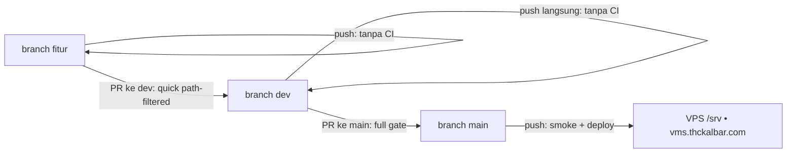

# CI/CD - THC Visitor Management System

Dokumen ini menjelaskan cara kode sampai ke produksi. Ditulis 2026-11-16.
Satu repo, dua branch: `dev` (kerja) → `main` (produksi, deploy ke VPS).

---

## 1. Ringkasan



- Branch default kerja: `dev`. Semua pengembangan terjadi di `dev`.
- `main` = produksi. Satu-satunya jalan ke `main` adalah merge PR dari `dev`.
  Push ke `main` = deploy (hanya via merge, lihat §2).
- E2E Playwright **tidak jalan di CI** (runner VPS kentang); jalankan lokal.

## 2. Branch protection `main`

Aktif via API Gitea (2026-11-16, Gitea 1.27.0):

| Aturan | Nilai |
|---|---|
| Direct push | diblokir (`enable_push=false`) |
| Merge | hanya via PR yang checks-nya hijau |
| Required check | `ci / backend (pull_request)`, `ci / frontend (pull_request)` |
| Required approval | 0 (tim kecil; gate-nya full CI) |

Catatan: `GET /branches/main/protection` menjawab 404 di Gitea 1.27.0 — itu
keterbatasan API, bukan berarti mati. Sumber sahih: `GET /branch_protections`.
`block_admin_merge_override=false`: admin teknisnya masih bisa override; andalkan
disiplin, bukan celah.

## 3. Workflow (`.gitea/workflows/`)

| File | Pemicu | Isi |
|---|---|---|
| `ci.yml` | PR `dev` (job `changes` + `*-quick` path-filtered), PR `main` + manual (job full) | Quick: build+vet, lint+typecheck, tanpa test/build; hanya jalan bila jalurnya tersentuh (docs-only hijau instan). Full: backend build/vet/test + false-green guard (counter transaksi DB), frontend install/lint/typecheck/test/build. Push tidak memicu apa pun. |
| `deploy.yml` | push ke `main` | Satu step: `bash deploy/deploy.sh` di runner VPS. |
| `security.yml` | manual saja | Advisory scan (govulncheck, npm audit, trivy, SBOM); tidak memblokir alur dev → main. Jadwal mingguan dimatikan Nov 2026 karena baseline merah dan tidak ditriase — jalankan manual sebelum upgrade dependensi. |

Aturan serialisasi: semua job berbagi `concurrency.group: ci` (atau `deploy`)
dengan `cancel-in-progress: false` — runner tunggal serumah produksi, run
antre, tidak pernah dibatalkan di tengah jalan.

Aturan main: "dev PRs are advisory, dev→main PR is the gate" — hanya gate PR
ke `main` yang wajib hijau (branch protection); gate PR ke `dev` adalah sinyal
review, bukan penghalang merge. `dev` sendiri tidak diproteksi (direct push
tetap boleh, tanpa CI) — friksi rendah untuk tim kecil.

## 4. Deploy di VPS (`deploy/deploy.sh`)

Berjalan **di VPS** via runner `vms-thc` (self-hosted, bukan di server Gitea).
Idempoten, `set -euo pipefail`, tidak pernah menimpa `.env`.

Urutan: sync repo → cek `.env`/CHANGEME → bersihkan container orphan (volume
tidak disentuh) → snapshot image aktif (`:rollback-<TS>`) → infra up → migrate
bila DB kosong → `up -d --build` → tunggu backend `/ready` → tunggu frontend
via caddy → **smoke test** → cleanup tag rollback lama → prune dangling → `ps`.

### Smoke test (gagal = rollback otomatis)

Lewat caddy (satu origin produksi), bukan langsung ke container:

| Cek | Harap |
|---|---|
| `GET /api/v1/health` | 200 + body memuat `healthy` |
| `GET /login` | 200 |
| `GET /api/v1/settings/system` tanpa token | 401 (membuktikan rantai auth-middleware ikut ter-deploy) |

### Rollback otomatis

Bila smoke gagal: tag `rollback-<TS>` dikembalikan ke nama utama → `up -d
--force-recreate backend frontend` (tanpa `--build`) → tunggu + smoke ulang →
lapor `ROLLBACK OK` dan exit 1 (run merah, tapi produksi serving versi lama).
Migrasi **tidak** di-rollback (forward-only); rollback code wajib
backward-compatible — sama seperti `git revert` di runbook.

Tag rollback: hanya 1 generasi terbaru per service yang disimpan; sisanya
dihapus otomatis tiap deploy sukses.

## 5. Perawatan VPS (cron)

Skrip: `deploy/vps-maintenance.sh` — prune build cache + image dangling +
lapor disk (warning bila `/` ≥ 85%). Volume & data tidak disentuh.
Salinan aktif di VPS: `/home/vms/vps-maintenance.sh` (di luar repo agar
`git reset --hard` saat deploy tidak konflik dengan file tracked yang sama;
salin ulang dari repo setiap skrip berubah).

Crontab di VPS (`crontab -l` untuk cek):

```cron
0 20 * * 6 /home/vms/vps-maintenance.sh >> /home/vms/vps-maintenance.log 2>&1
```

Sabtu 20:00 UTC = Minggu 03:00 WIB, log di `/home/vms/vps-maintenance.log`.
Insiden Nov 2026: build cache 24GB membuat disk 99% dan CI merah; prune perdana
mereklamasi 7,7GB (79% → 63%).

## 6. Masalah yang mungkin terjadi

| Gejala | Penyebab | Solusi |
|---|---|---|
| CI merah `no space left` / docker gagal | Disk VPS penuh (build cache) | Jalankan `deploy/vps-maintenance.sh` di VPS; cek cron §5 |
| `npm ci` gagal sebelum lint/test | Cache npm runner korup / registry flaky | Cache persisten host-path + `npm cache verify` tiap run + fetch tuning (`--prefer-offline`, retry bounded); nuke cache otomatis bila 3x gagal. Baseline Nov 2026: job frontend success 7–8,5 menit, backend ~3–3,5 menit. |
| Test backend 0 transaksi / guard merah | Postgres CI mati di tengah run | Rerun workflow; skrip `ci-pg.sh` menangani start/prepare |
| `git status` ratusan `M` padahal tak edit | CRLF phantom (`core.autocrlf=true`) | `git config core.autocrlf false` lalu `git restore .`; isi sama, hanya line-ending |
| `migrate: database is dirty` | Migrasi tidak idempoten terpotong | Perbaiki SQL jadi idempoten (`IF NOT EXISTS`), `UPDATE schema_migrations SET dirty=false`, migrate ulang |
| `docker ... permission denied` di log CI | Runner kehilangan group docker | Sudah ditangani: wrapper `docker_cli` (direct → sudo -n → sg); bila semua gagal, `usermod -aG docker` + restart runner |
| `port is already allocated` saat up | Container stack lama masih hidup | Sudah ditangani: pembersihan container orphan di `deploy.sh` |
| Protection memblokir merge padahal hijau | Nama context check tidak cocok | Context wajib persis `ci / backend (pull_request)` — cek status commit via API |

Rerun tanpa klik UI: `POST /repos/thckalbar/vms/actions/runs/{id}/rerun`
(basic auth user Gitea). Log job mentah via API mengembalikan 404 — diagnosis
lewat daftar step + reproduksi lokal + SSH ke VPS bila perlu.

## 7. Rollback manual & deploy darurat

Rollback code (bertahan lama): `git revert` commit masalah di `main` → push
(bukan `git reset --hard` di VPS — `deploy.sh` selalu me-reset ke
`origin/main`). Migrasi tidak di-revert; pastikan revert backward-compatible.

Rollback container darurat (di VPS): tag `thc-vms-prod-<svc>:rollback-<TS>`
masih menyimpan 1 generasi — `docker tag` balik + `compose up -d`.

Deploy manual darurat (runner mati): SSH ke VPS, `cd /home/vms/thc-vms`,
`bash deploy/deploy.sh` (script self-sync + self re-exec bila berubah).

## 8. Kebijakan E2E

Playwright hanya lokal (`frontend/npm run e2e`, butuh backend :8080 +
frontend :3210 jalan). Flaky yang pernah ditangani: `@VC-01` (race
`getBoundingClientRect` = 0 saat refetch) — assertion dipindah ke dalam
`expect.poll`; `@VFP-02` terbukti false negative (lolos retest).
